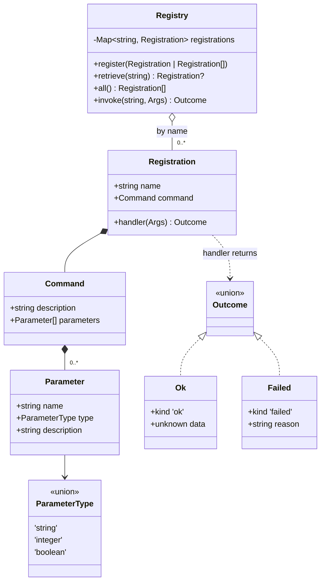
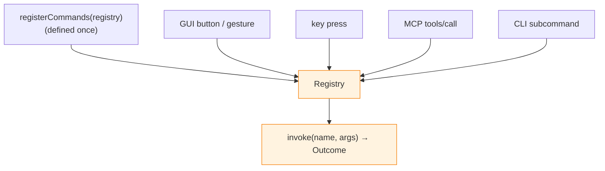

# Architecture

Core only. Adapters are out of scope for now, so this is the whole picture.

## Types

A `Registry` holds `Registration`s keyed by name; each pairs a self-describing
`Command` with the handler that runs it. Handlers take a loosely-typed argument
map and return an `Outcome` — the narrow waist every surface translates to and
from.

## One registry, many surfaces

Commands are registered once. Every surface dispatches the *same* handlers
through `Registry.invoke` — this is the core thesis. The prototype ran it
across four surfaces off one set of registrations; none of those adapters
exist here yet, but the shape core presents to them is unchanged.

Dispatch is by-name at the command level only. The registry is a symbol table:
command *names* are string-keyed and the lookup is fallible, but the handler
behind a found command is already bound as a value at registration — so the
classic resolve-name-then-resolve-function two-step collapses to one fallible
step.