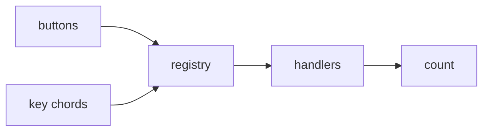
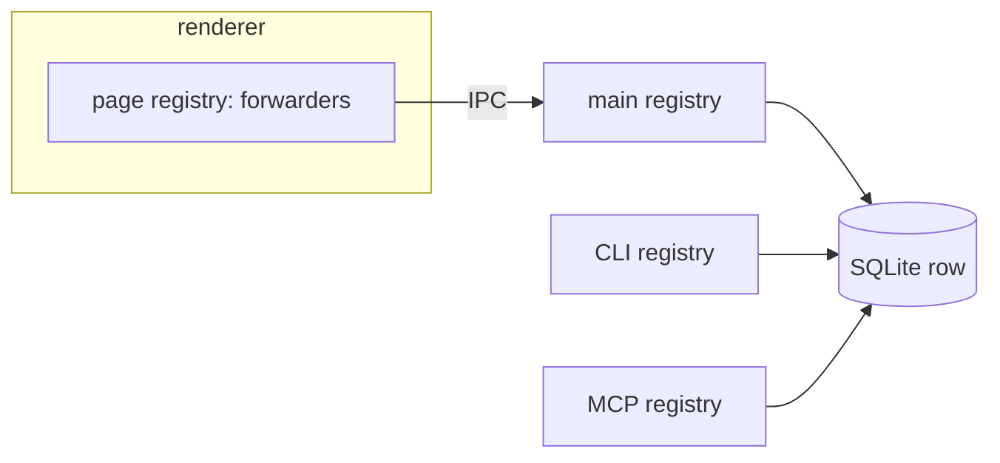
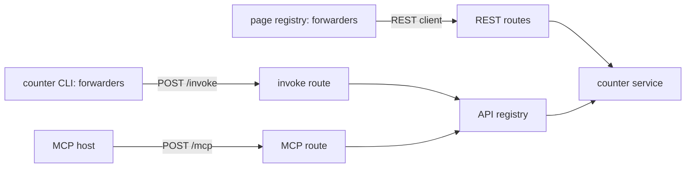

# Examples

The repository's `examples/` directory builds the same app three ways: a counter with `increment`,
`decrement`, and `reset`. The examples share no code on purpose. What changes between them is where
the registry lives and how surfaces reach it.

## Browser

[`examples/browser`](https://github.com/ufo-soft/caelus/tree/main/examples/browser): one process.
The counter, the registry, and both surfaces live in the page.

The handlers are bound to shared descriptions with `bind`. The buttons are built from
`registry.all()`, and a textarea on the page is the keymap source, so editing it and reloading
changes the chords. A `clearLog` command with a local handler sits beside the counter commands.

## Desktop

[`examples/desktop`](https://github.com/ufo-soft/caelus/tree/main/examples/desktop): an Electron
app whose counter is one row in a SQLite file. Three processes each hold a registry with real
handlers on that file: Electron main, the CLI, and the MCP server. None of them forwards to another.
They share the data, not a registry.

The renderer's registry holds forwarders whose `send` goes over the preload bridge to Electron main,
which invokes its registry and returns the outcome. The CLI and the MCP server work whether the
window is open or not, and the window sees their changes when it next reads the count.

## Web

[`examples/web`](https://github.com/ufo-soft/caelus/tree/main/examples/web): an AdonisJS API owns
the counter in SQLite behind its own REST routes. The registry sits beside the REST API, not inside
it: its handlers call the same service the REST controller calls.

- The page forwards into a REST client: each command's `send` makes the matching REST call. The
  page never uses the invoke route.
- The `counter` CLI is a standalone binary. Its forwarders post the name and args to the API's
  invoke route. `counter --mcp` serves the same forwarders as an MCP server over stdio.
- The API also serves its registry as an MCP server over streamable HTTP.

The page, the CLI, and the API share one description file from the API's source, which imports
nothing at runtime. Removing the registry leaves a normal Adonis app.
