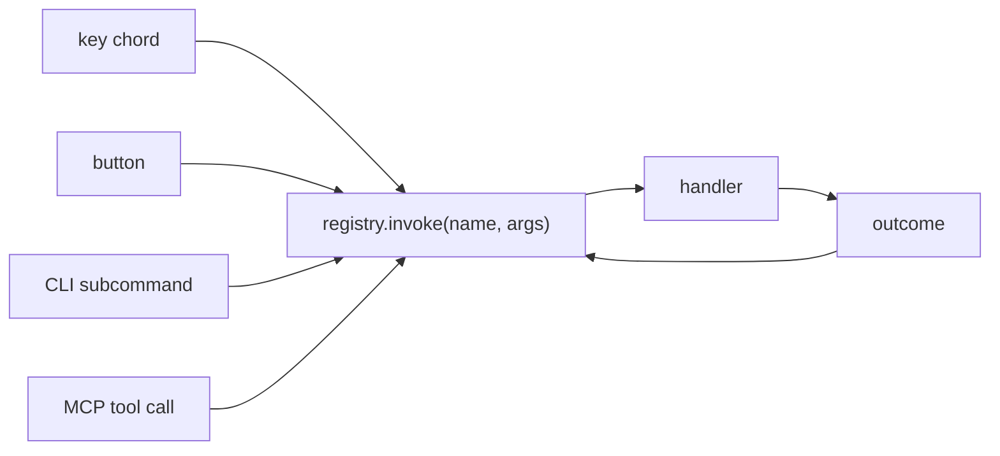
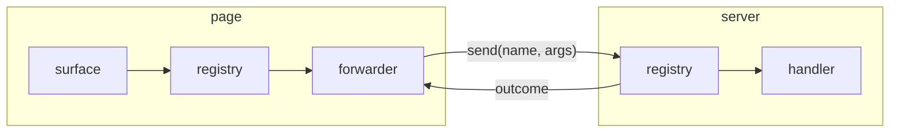

# Architecture

Caelus has one narrow point every surface passes through: `registry.invoke(name, args)`, which
returns a promise of an outcome. Surfaces translate their input into a name and args, and translate
the outcome back into their output. Nothing in the registry knows which surface called it.

## Commands are data

A command is a description and a list of parameters. Because it is data, a surface can build
itself from the registry: the CLI reads the parameters to build options, the MCP server reads them
to build input schemas, and a page reads `registry.all()` to build buttons. None of them has a line
of code per command.

The same data is what two processes share. Descriptions live in a file with no runtime imports, and
each process binds its own handlers to them with `bind` or `forward`.

## Outcomes are values

A handler returns `ok(data)` or `failed(reason)` instead of throwing. Every surface already has a
way to show both: the CLI prints data or exits 1 with the reason, the MCP server returns a text
block or an error result, a page renders data or shows the reason. An outcome is also plain data,
so it crosses a process boundary as JSON unchanged.

## Invoke is always asynchronous

`invoke` returns a promise even when the handler is synchronous. A local handler and a forwarder
that waits on a network call look the same to the caller, so a surface never changes when a command
moves to another process.

## Dispatch is by name

The registry maps names to registrations. Looking up a name is the only step that can fail, and it
fails as an outcome: `no command named <name>`. The handler behind a found name is already a
function, so there is no second lookup.

## One registry per process

A registry lives in one process. When commands run somewhere else, the process that receives the
input holds forwarders, and the process that owns the data holds the handlers. Every process has a
complete registry of its own.

## Packages follow dependencies

The core module has no dependencies. Keybindings ships in the same package and brings one, its TOML
parser. The CLI needs commander and the MCP server needs the MCP SDK and zod, so each is its own
package, and an app installs only the surfaces it uses.

See [the examples](./examples.md) for three apps built on these choices, and
[known limits](./limits.md) for what Caelus does not do.
